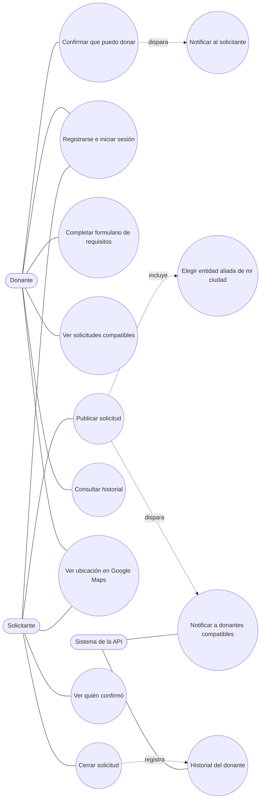
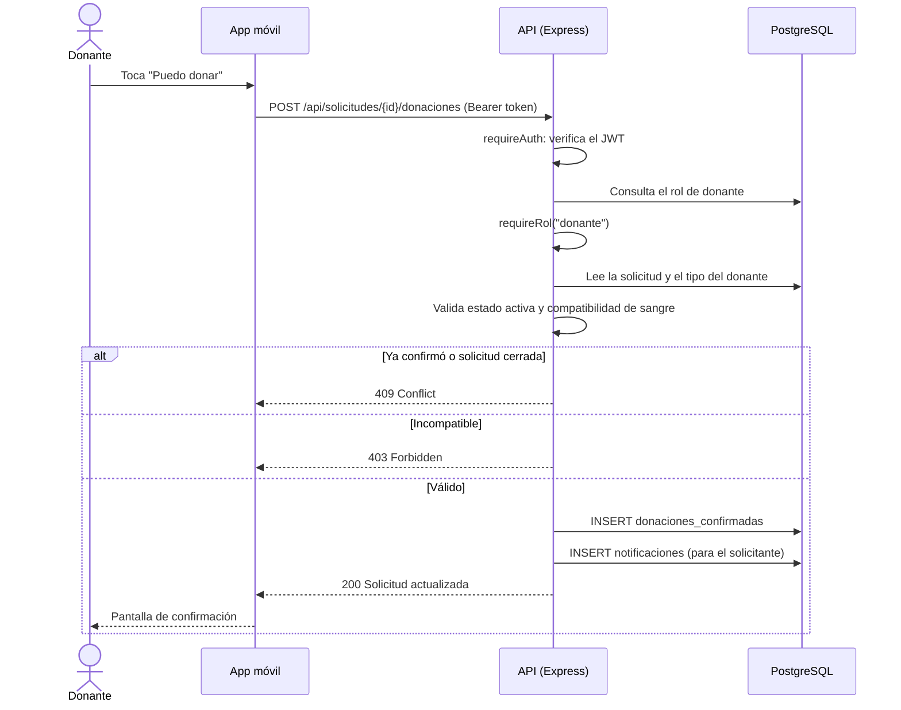
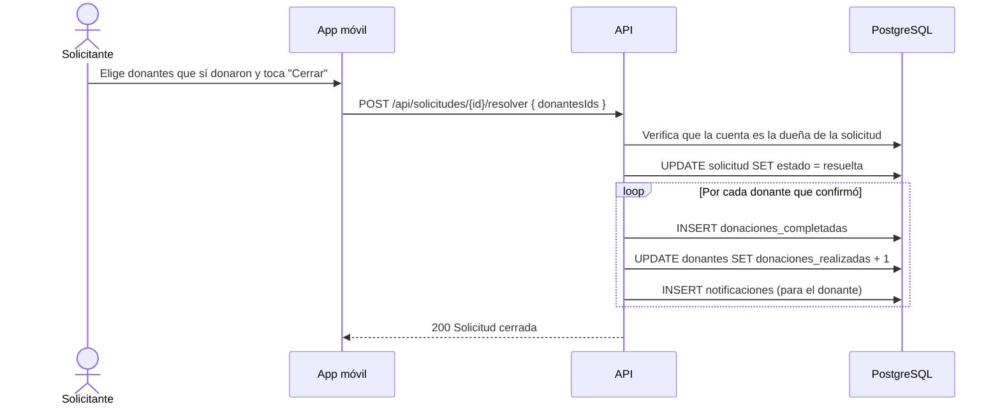
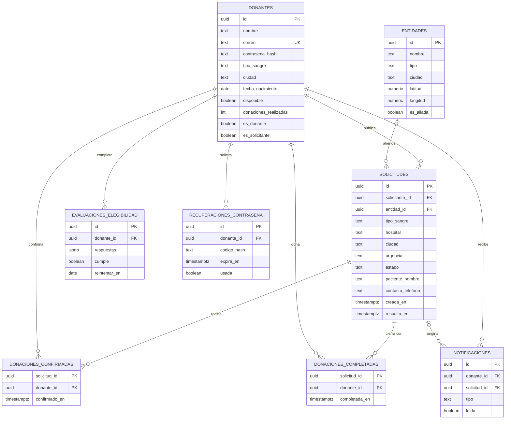
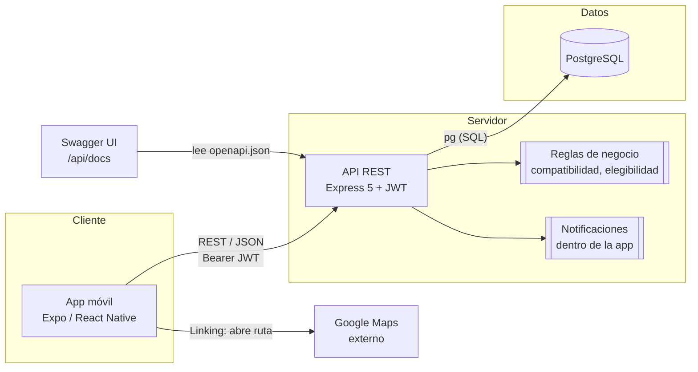
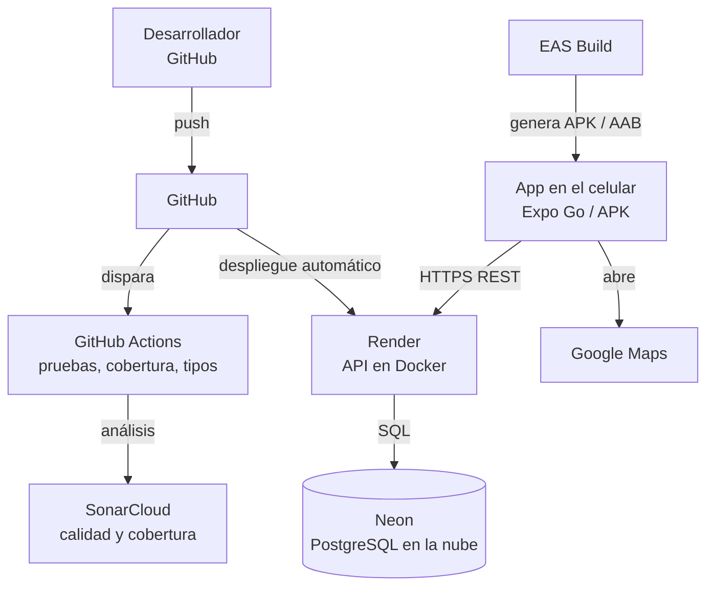

# 2. Diagramas

Todos los diagramas están escritos en **Mermaid**, que GitHub muestra directamente. Corresponden al sistema tal como está implementado.

## 2.1 Diagrama de casos de uso

## 2.2 Diagrama de secuencia: confirmar una donación

## 2.3 Diagrama de secuencia: cerrar una solicitud

## 2.4 Diagrama entidad-relación

**Integridad referencial:** las claves foráneas usan `ON DELETE CASCADE` para datos que dependen de una cuenta (notificaciones, evaluaciones, recuperaciones) y `ON DELETE SET NULL` cuando la solicitud debe sobrevivir a la borrada de una entidad.

## 2.5 Diagrama de componentes

## 2.6 Diagrama de arquitectura (infraestructura)

